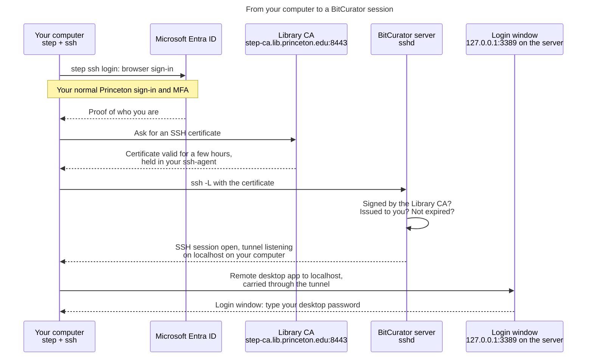

# Using the BitCurator desktop

This guide is for people who use the Library's BitCurator Virtual Desktops. It does
not assume you know or use Ansible, and you never need this repository. Every
command here runs on **your own computer**, apart from one command in the
one-time setup that runs on the Virtual Desktop.

The guide is in four parts:

1. [Before you start](#before-you-start): what you need
2. [One-time setup](#one-time-setup): done once and not repeated
3. [Each time you use BitCurator](#each-time-you-use-bitcurator): the steps
   for every session
4. [Troubleshooting](#troubleshooting)

Operators who build and maintain the Virtual Desktop should read [ANSIBLE.md](ANSIBLE.md).

## Before you start

You need all of the following before the setup will work.

| You need | Why | How to get it |
| --- | --- | --- |
| A Princeton NetID with multi-factor authentication | You sign in with your normal Princeton (Microsoft Entra) account | You already have it |
| An account on the BitCurator Virtual Desktop | The Virtual Desktop only lets in people it was set up for | Ask the operations team to add you. Until they do, you get `Permission denied (publickey)` |
| The Desktop's name | You connect to it by name | The operations team gives it to you, for example `lib-vm-bitcur1.princeton.edu` |
| The certificate authority fingerprint | Lets your computer check it is talking to the real Library certificate authority | The operations team gives it to you on Slack or in person. Do not use one from an email or a web page someone sent you |
| A Mac or a Windows 10/11 PC where you can install software | You install two small programs | Ask Desktop support if your computer is managed |
| A connection to the Princeton network | The Virtual Desktop is not on the public internet | Connect on campus, or use the Princeton VPN (GlobalProtect) |
| The `step` command | Gets you a sign-in certificate | See [Install the software](#1-install-the-software) |
| A remote desktop app | Shows you the BitCurator desktop | **Windows App** on macOS; **Remote Desktop Connection** comes with Windows |

## How connecting works

The BitCurator desktop's login window is not on the network. Only the Virtual Desktop
itself can reach it. You get to it through an SSH connection, and that SSH
connection accepts only a short-lived certificate. You get the certificate by
signing in with your Princeton account and MFA.

So every session takes three steps, and each one needs the step before it:

1. **Get a certificate.** `step ssh login` opens a browser. You sign in to
   Microsoft as usual, and the Library certificate authority gives you an SSH
   certificate that lasts a few hours.
2. **Open a tunnel.** `ssh -L` uses that certificate to connect to the Virtual Desktop.
   It carries the desktop back to your computer.
3. **Open the desktop.** Your remote desktop app connects to `localhost`, and
   the tunnel delivers that connection to the server's login window. There you
   type your **desktop password**, a local password you set during the
   one-time setup.



Keep two things in mind:

- **A remote desktop app pointed at the server's name never connects.**
  Nothing on the network answers on the desktop port, and that is deliberate.
  Always connect to `localhost`.
- **The desktop stays connected only while the SSH window is open.** If you
  close that terminal, the desktop disconnects.

## One-time setup

You do these steps once. You repeat them only in the cases noted under each
step.

### 1. Install the software

You do this once per computer.

#### macOS

Install `step` with [Homebrew](https://brew.sh):

```sh
brew install step
step version
```

macOS already has `ssh` and a running `ssh-agent`, so you don't need anything
else for the connection.

For the desktop, install **Windows App** (previously called *Microsoft Remote
Desktop*) from the Mac App Store.

#### Windows 10 and 11

Install `step` from PowerShell with winget:

```powershell
winget install Smallstep.step
```

Close PowerShell and open it again so it picks up the new `PATH`. Then check
the install:

```powershell
step version
```

If winget is not available, download the Windows `.zip` from the
[step releases page](https://github.com/smallstep/cli/releases/latest). Unpack
`step.exe` into a folder you will keep, and add that folder to your `PATH`.

Windows includes the OpenSSH client, but its **ssh-agent service is off by
default**, and `step ssh login` needs it to hold your certificate. Turn the
service on once. Open PowerShell with **Run as administrator** and run:

```powershell
Get-Service ssh-agent | Set-Service -StartupType Automatic
Start-Service ssh-agent
```

For the desktop, use **Remote Desktop Connection** (`mstsc`), which comes with
Windows.

> Run the `ssh` commands in this guide in **PowerShell or Windows Terminal**,
> not Git Bash. Git Bash has its own `ssh`, which cannot see the Windows agent.
> It does not find your certificate and asks for a password instead.

### 2. Trust the Library certificate authority

You do this once per computer:

```sh
step ca bootstrap --ca-url https://step-ca.lib.princeton.edu:8443 \
  --fingerprint <fingerprint>
```

On Windows, type it on one line, or replace the `\` at the end of the first
line with a backtick (`` ` ``).

Replace `<fingerprint>` with the value the operations team gave you. This
command creates a configuration folder (`~/.step`, or `%USERPROFILE%\.step` on
Windows). You run it again only if that folder is deleted or you move to a new
computer.

### 3. Set your desktop password

You do this once per person, for each server. The login window uses this
password and nothing else does. It is **not** your Princeton password, and
nobody else knows it.

```sh
STEP_OPEN_BROWSER=0 step ssh login <netid>@princeton.edu --provisioner "Princeton Entra OIDC"
ssh <netid>@<server>
sudo /usr/local/sbin/set-desktop-password
exit
```

Replace `<netid>` with your NetID and `<server>` with the server's full name.
The `sudo` line is the one command in this guide that runs on the server.

If the server is rebuilt, your desktop password is lost, and you set it again
the same way. Your files and your access are not affected.

## Each time you use BitCurator

You follow these steps every time you want the desktop.

### macOS

In Terminal:

```sh
step ssh login <netid>@princeton.edu --provisioner "Princeton Entra OIDC"
ssh -L 3389:localhost:3389 <netid>@<server>
```

Leave that Terminal window open. In Windows App, add a PC named
**`localhost:3389`** and connect to it. You add the PC the first time only;
after that, double-click it.

### Windows

In PowerShell:

```powershell
step ssh login <netid>@princeton.edu --provisioner "Princeton Entra OIDC"
ssh -L 13389:localhost:3389 <netid>@<server>
```

Leave that window open. In Remote Desktop Connection, connect to
**`localhost:13389`**.

Windows uses port `13389` on your computer instead of `3389`. Your PC may
already use `3389` for its own Remote Desktop, and Remote Desktop Connection
refuses to connect to `localhost:3389` anyway. The server still uses `3389`;
only the port on your computer is different.

### At the login window

Enter your NetID as the username and the desktop password from
[step 3](#3-set-your-desktop-password) of the one-time setup.

### On the desktop

- The BitCurator tools are in the **Applications** menu.
- The Library's helper scripts (acquiring disk images, building reports,
  validating bags, mounting storage) are in
  `/home/bcadmin/Desktop/scripts/code`.
- The shared working folders under `/home/bcadmin` belong to the `bcadmin`
  group, and you are a member of it. Files you create there stay readable by
  the rest of the team.
- Storage is mounted under `/mnt`: `/mnt/data`, `/mnt/rbrr`,
  `/mnt/archives_bd` and `/mnt/raid`.

### When you finish

Log out of the desktop from its menu, then close the SSH window, or type `exit`
in it.

### When your certificate expires

Certificates last a few hours. If `ssh` starts asking for a password or reports
`Permission denied (publickey)`, run `step ssh login` again. To see the
certificates you hold and when they expire, run:

```sh
step ssh list
```

## Troubleshooting

| Symptom | Cause and fix |
| --- | --- |
| Remote desktop app cannot connect (`0x204` on macOS) | The app is pointed at the server's name instead of `localhost`, or the SSH window holding the tunnel is closed |
| `bind [127.0.0.1]:3389: Address already in use` | You ran `ssh -L` on the server instead of on your computer. On Windows, your PC may be using 3389: use `13389` as shown above |
| `ssh` asks for a password | You have no valid certificate: run `step ssh login` again. On Windows, also check that you are in PowerShell, not Git Bash, and that the ssh-agent service is running |
| `Permission denied (publickey)` with a new certificate | You don't have an account on this server yet. Ask the operations team |
| `Too many authentication failures` | Your agent offers other keys first, and the server stops before it reaches the certificate. Run `ssh-add -D`, then `step ssh login` again |
| `step ssh login` asks which provisioner to use | Choose **Princeton Entra OIDC**, or add `--provisioner` as shown above |
| The browser never opens for sign-in | Add `--console` to `step ssh login`, and open the link it prints yourself |
| The browser opens already signed in as someone else | Your browser remembers another Microsoft account. Stop `step` opening the browser, and open the link it prints in a private window (see below) |
| The login window rejects your password | Your desktop password is wrong or was never set. Repeat [step 3](#3-set-your-desktop-password) of the one-time setup |
| `ssh` cannot reach the server at all | You are off campus without the VPN, or the server name is wrong |
| The desktop opens and then closes immediately | This is a server problem, not a sign-in problem. Tell the operations team |

`ssh-add -D` removes every key from your agent, including any you use for
GitHub. They come back the next time you add them or restart your computer.

If the browser signs you in with someone else's account, set
`STEP_OPEN_BROWSER=0` so `step` prints the sign-in link instead of opening it.
Copy the link into a private or incognito window and sign in as yourself.

On macOS:

```sh
STEP_OPEN_BROWSER=0 step ssh login <netid>@princeton.edu --provisioner "Princeton Entra OIDC"
```

On Windows, in PowerShell:

```powershell
$env:STEP_OPEN_BROWSER = "0"
step ssh login <netid>@princeton.edu --provisioner "Princeton Entra OIDC"
```

On Windows the setting lasts until you close that PowerShell window.

## How the server checks you

For the server-side detail (how sshd checks the certificate, how the identity
in it maps to your local account, and why the server can still refuse you), see
the [`ssh_ca_trust` authentication flow](../ssh_ca_trust/AUTH_FLOW.md). For why
the login window is closed to the network, see the
[`xrdp_ca_login` README](../xrdp_ca_login/README.md).
