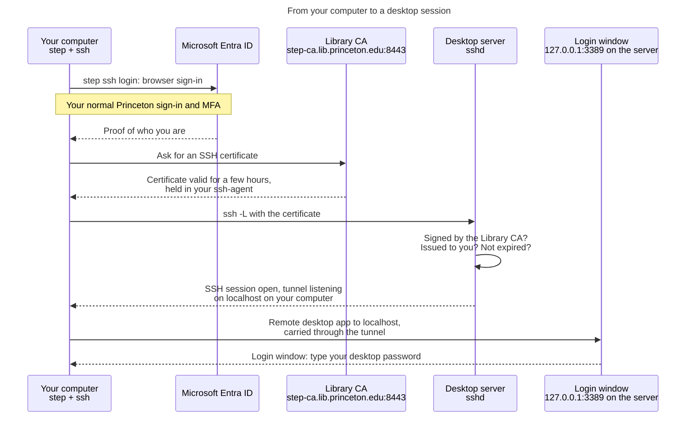

Connecting to a remote desktop
==============================

For people who sign in to a desktop configured by this role and have no reason
to touch Ansible. It covers what happens when you connect, how to install the
`step` command on macOS or Windows, and the commands you run each time.

Everything here runs on **your own computer**. Nothing is installed on the
server, and you never need this repository.

What you are doing, and why
---------------------------

The desktop's login window is not on the network. It listens only on the
server's own loopback address, so the one way to reach it is through an SSH
connection, and that SSH connection only accepts a short-lived certificate
issued after you sign in with your Princeton (Entra ID) account and MFA.

So getting to a desktop is three steps, each depending on the one before:

1. **Get a certificate.** `step ssh login` opens a browser, you sign in to
   Microsoft as usual, and the Library certificate authority gives you an SSH
   certificate that lasts a few hours.
2. **Open a tunnel.** `ssh -L` connects to the server with that certificate and
   carries the desktop port back to your computer.
3. **Open the desktop.** Your remote desktop app connects to `localhost`, which
   the tunnel delivers to the server's login window. There you type your
   **desktop password**, a local password you set yourself once.



Two consequences worth knowing up front:

- **An RDP app pointed straight at the server's name will never connect.**
  Nothing on the network answers on the desktop port. That is the design, not a
  fault. Always connect to `localhost`.
- **The tunnel lives only as long as the SSH window.** Close that terminal and
  the desktop disconnects.

Install the step command
------------------------

`step` is Smallstep's command-line tool. You need it once per computer.

### macOS

With [Homebrew](https://brew.sh):

```sh
brew install step
step version
```

macOS already has `ssh` and a running `ssh-agent`, so nothing else is needed.

For the desktop itself, install **Windows App** (formerly *Microsoft Remote
Desktop*) from the Mac App Store.

### Windows 10 and 11

Install `step` from PowerShell with winget:

```powershell
winget install Smallstep.step
```

Close and reopen PowerShell so the new `PATH` is picked up, then check it:

```powershell
step version
```

If winget is not available, download the Windows `.zip` from the
[step releases page](https://github.com/smallstep/cli/releases/latest), unpack
`step.exe` somewhere permanent, and add that folder to your `PATH`.

Windows ships the OpenSSH client, but its **ssh-agent service is disabled by
default**, and `step ssh login` needs it to hold your certificate. Turn it on
once, from PowerShell opened with **Run as administrator**:

```powershell
Get-Service ssh-agent | Set-Service -StartupType Automatic
Start-Service ssh-agent
```

Use the built-in Remote Desktop Connection app (`mstsc`) for the desktop.

> Run the `ssh` commands below in **PowerShell or Windows Terminal**, not Git
> Bash. Git Bash brings its own `ssh` that cannot see the Windows agent, so it
> will not find your certificate and will ask for a password instead.

One-time setup
--------------

### 1. Trust the Library certificate authority

Once per computer:

```sh
step ca bootstrap --ca-url https://step-ca.lib.princeton.edu:8443 \
  --fingerprint <fingerprint>
```

On Windows, put it on one line, or replace the trailing `\` with a backtick.

Get `<fingerprint>` from the operations team over a channel you already trust
(Slack, or in person). It is how `step` knows it is talking to the real CA, so
do not copy it from an email or a web page you were sent. This writes a
configuration folder (`~/.step`, or `%USERPROFILE%\.step` on Windows); you do
not run it again unless that folder is deleted.

### 2. Set your desktop password

Once per person, per desktop server. This password is used only by the desktop
login window. It is **not** your Princeton password, and nobody else knows it.

```sh
step ssh login <netid>@princeton.edu --provisioner "Princeton Entra OIDC"
ssh <netid>@<server>
sudo /usr/local/sbin/set-desktop-password
exit
```

`<server>` is the full name you were given, for example
`sandbox-bitcur2.princeton.edu`. If the server is rebuilt, this password
is lost and you set it again the same way.

Each time you want the desktop
------------------------------

### macOS

```sh
step ssh login <netid>@princeton.edu --provisioner "Princeton Entra OIDC"
ssh -L 3389:localhost:3389 <netid>@<server>
```

Leave that terminal open. In Windows App, add a PC with the name
**`localhost:3389`** and connect.

### Windows

```powershell
step ssh login <netid>@princeton.edu --provisioner "Princeton Entra OIDC"
ssh -L 13389:localhost:3389 <netid>@<server>
```

Leave that window open. In Remote Desktop Connection, connect to
**`localhost:13389`**.

Windows uses local port `13389` rather than `3389` because your own PC may
already be using `3389` for its own Remote Desktop, and Remote Desktop
Connection refuses to connect to `localhost:3389` in any case. The server end
stays `3389`; only the port on your computer changes.

### When the certificate expires

Certificates last a few hours. When `ssh` starts asking for a password or
reports `Permission denied (publickey)`, run `step ssh login` again. You can see
what you currently hold, and when it expires, with:

```sh
step ssh list
```

Troubleshooting
---------------

| Symptom | Cause and fix |
| --- | --- |
| Remote desktop app cannot connect (`0x204` on macOS) | It is aimed at the server's name rather than `localhost`, or the SSH window holding the tunnel was closed |
| `bind [127.0.0.1]:3389: Address already in use` | The `ssh -L` command is being run on the server instead of on your computer, or (Windows) your PC is using 3389; use `13389` as above |
| `ssh` asks for a password | No valid certificate: run `step ssh login` again. On Windows, also check you are in PowerShell, not Git Bash, and that the ssh-agent service is running |
| `Permission denied (publickey)` with a fresh certificate | Your account has not been added to this server yet; ask the operations team |
| `Too many authentication failures` | Your agent offers other keys first and the server gives up before reaching the certificate. Run `ssh-add -D`, then `step ssh login` again |
| `step ssh login` asks which provisioner to use | Choose **Princeton Entra OIDC**, or pass `--provisioner` as shown above |
| Browser never opens for sign-in | Add `--console` to `step ssh login` and open the printed link yourself |
| Login window refuses your password | Desktop password wrong or never set; repeat step 2 of the one-time setup |
| Desktop opens, then closes immediately | A problem on the server, not with your sign-in; tell the operations team |

`ssh-add -D` removes every key from your agent, including any you use for
GitHub. They come back the next time you add them or restart your computer.

How the server decides
----------------------

For the server-side detail (how sshd checks the certificate offline, how the
principal in it maps to your local account, and why `AllowUsers` can still
refuse you) see the [`ssh_ca_trust` authentication flow](../ssh_ca_trust/AUTH_FLOW.md).
For why the login window is bound to loopback at all, see this role's
[README](README.md).
